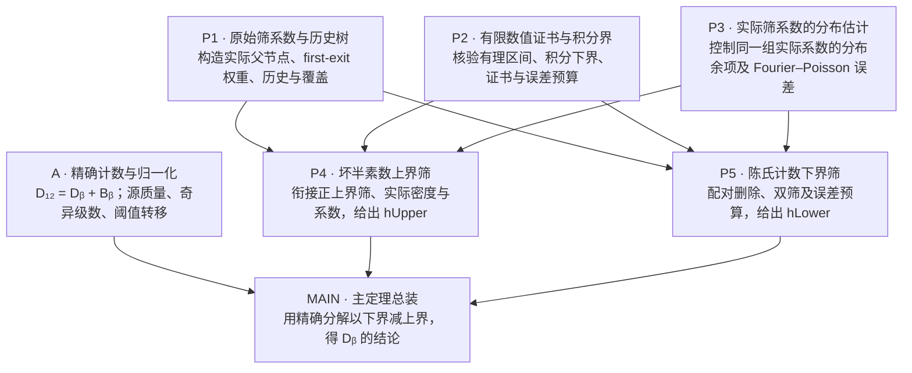

# Goldbach 1+1.75 Lean 形式化仓库

## 主定理

Slava Chan 的[预印本](https://github.com/UyNewNas/chen-imbalanced-semiprimes)提出：每个充分大的偶数 $N$ 均可写为 $N=p+rq$，其中 $p,q$ 为素数，$r=1$ 或为素数，且 $r\le q^{3/4}$。

对每个固定实数 $1/2<b<1$，稿本的定量目标为

$$
\liminf_{\substack{N\to\infty\\2\mid N}}\frac{D_b(N)}{H_N}
\ge 1.96176252-6.7617368\log(1/b),
\qquad H_N=\frac{C_N N}{(\log N)^2}.
$$

$D_b(N)$ 按满足 $r\le q^b$ 的表示中不同的加法素数 $p$ 计数，每个 $p$ 只计一次，保留 $r=1$ 的表示。稿本不提供有效的 $N$ 阈值。[2026 年 11 月 6 日冻结版（中英文）](https://github.com/UyNewNas/chen-imbalanced-semiprimes/tree/a988cba584d803ae2856a0de50efb582f4f3dd6a/paper/release-20261106)。

**Lean 状态：形式化进行中。** 默认分支已验收 Part A 的组合入口，尚未完成整条无条件证明。

## 形式化工程概览

下图表示稿内证明义务如何汇入总装，不是 Lean 文件的导入图。

## 模块状态

| 模块编号 | 模块名称 | 状态 | 模块 PR | 最新提交 |
| --- | --- | --- | --- | --- |
| A | 精确计数与归一化 | 组合验收通过，已合入 `master`；[验收回执](verification/part-a/current/RECEIPT.json) | [#9](https://github.com/UyNewNas/goldbach-formalization/pull/9)（已合并） | [`980068c7`](https://github.com/UyNewNas/goldbach-formalization/commit/980068c76fef46adf5974552e51f95625af7e4c0) |
| P1 | 原始筛系数与历史树 | 草稿已收录 4 个验收子节点，整模块未闭合 | [#10](https://github.com/UyNewNas/goldbach-formalization/pull/10)（草稿） | [`1eb38a70`](https://github.com/UyNewNas/goldbach-formalization/commit/1eb38a70d5cd494c3b1d577c8d01659effcdc573) |
| P2 | 有限数值证书与积分界 | 草稿已收录 6 个验收子节点，整模块未闭合 | [#11](https://github.com/UyNewNas/goldbach-formalization/pull/11)（草稿） | [`6f5ce7fd`](https://github.com/UyNewNas/goldbach-formalization/commit/6f5ce7fd0aa2931f3f38553567b7d45cb661cd65) |
| P3 | 实际筛系数的分布估计 | 草稿已收录 3 个验收子节点，整模块未闭合 | [#12](https://github.com/UyNewNas/goldbach-formalization/pull/12)（草稿） | [`e3007ef6`](https://github.com/UyNewNas/goldbach-formalization/commit/e3007ef6bf537e51b0c109bf24264a3d5ea3a955) |
| P4 | 坏半素数的上界筛 | 草稿已收录 2 个验收子节点，完整 `hUpper` 待闭合 | [#13](https://github.com/UyNewNas/goldbach-formalization/pull/13)（草稿） | [`ad78feec`](https://github.com/UyNewNas/goldbach-formalization/commit/ad78feecbe963b34143e16dd0cce999976eef321) |
| P5 | 陈氏计数的下界筛 | 草稿已收录 2 个验收子节点，完整 `hLower` 待闭合 | [#14](https://github.com/UyNewNas/goldbach-formalization/pull/14)（草稿） | [`781f405b`](https://github.com/UyNewNas/goldbach-formalization/commit/781f405b4d6393c17691afe4f98310111d2dc5d6) |
| MAIN | 主定理总装 | [条件式入口已有](ImbalancedChen/CurrentMainTheorem.lean)，无条件验收未完成 | 暂无独立 PR | [`00964560`](https://github.com/UyNewNas/goldbach-formalization/commit/00964560d324de25e602d51ed29f0734e5fc2c4c) |

最新提交按公开入口记录：A 为合并提交，P1–P5 为对应草稿 PR 的分支头，MAIN 为主分支最近一次修改总装源码的提交。分支头不等于验收版本；草稿 PR 收录的局部回执不代表其组合已通过编译、内核重放与公理审计。

## Lean 工具链与依赖

工具链：[Lean 4 v4.33.0-rc1](https://github.com/leanprover/lean4)（见 [lean-toolchain](lean-toolchain)）。下表为主分支 [lake-manifest.json](lake-manifest.json) 的锁定依赖；直接依赖声明在 [lakefile.toml](lakefile.toml)。

| Lake 包 | 仓库 | 固定提交 | 类型 |
| --- | --- | --- | --- |
| `goldbach` | [subfish-zhou/goldbach-lean](https://github.com/subfish-zhou/goldbach-lean) | [`09b97db5`](https://github.com/subfish-zhou/goldbach-lean/commit/09b97db5764ade1246bfb77206baa1b124760958) | 直接 |
| `mathlib` | [leanprover-community/mathlib4](https://github.com/leanprover-community/mathlib4) | [`e4c91783`](https://github.com/leanprover-community/mathlib4/commit/e4c91783ca8e6a7c693ae624ade32fd22d4e43c1) | 直接 |
| `LeanArchitect` | [hanwenzhu/LeanArchitect](https://github.com/hanwenzhu/LeanArchitect) | [`78dd6684`](https://github.com/hanwenzhu/LeanArchitect/commit/78dd66840d3efe8c824c699fc03381cec817c271) | 间接 |
| `plausible` | [leanprover-community/plausible](https://github.com/leanprover-community/plausible) | [`b1c4a69a`](https://github.com/leanprover-community/plausible/commit/b1c4a69a7e247ab7df20460212001673d74f08c0) | 间接 |
| `LeanSearchClient` | [leanprover-community/LeanSearchClient](https://github.com/leanprover-community/LeanSearchClient) | [`0498c7c0`](https://github.com/leanprover-community/LeanSearchClient/commit/0498c7c070c143a3bf7379f4d99a2c63bb9d9715) | 间接 |
| `importGraph` | [leanprover-community/import-graph](https://github.com/leanprover-community/import-graph) | [`18a90119`](https://github.com/leanprover-community/import-graph/commit/18a90119a5d316358fde6c86e0ca24e59212e32c) | 间接 |
| `proofwidgets` | [leanprover-community/ProofWidgets4](https://github.com/leanprover-community/ProofWidgets4) | [`b1436dc7`](https://github.com/leanprover-community/ProofWidgets4/commit/b1436dc749e722c9920036b52cdc43b3451d0b69) | 间接 |
| `aesop` | [leanprover-community/aesop](https://github.com/leanprover-community/aesop) | [`57d3325b`](https://github.com/leanprover-community/aesop/commit/57d3325be72a842920813bcb40f96a6f7393c185) | 间接 |
| `Qq` | [leanprover-community/quote4](https://github.com/leanprover-community/quote4) | [`ee41917a`](https://github.com/leanprover-community/quote4/commit/ee41917ae11d38479fb8fb24745f7ca4bf0a784d) | 间接 |
| `batteries` | [leanprover-community/batteries](https://github.com/leanprover-community/batteries) | [`41bd267b`](https://github.com/leanprover-community/batteries/commit/41bd267b3f6b7252f6676af46d4ffc6783b64de9) | 间接 |
| `Cli` | [leanprover/lean4-cli](https://github.com/leanprover/lean4-cli) | [`da07ca80`](https://github.com/leanprover/lean4-cli/commit/da07ca808b6718cb2aed14dba154e5a08b8f8ecf) | 间接 |

稿内使用的 PNT（素数定理）与加权 Mertens 输入经 [RealHalfProductMassSuppliers.lean](ImbalancedChen/RealHalfProductMassSuppliers.lean) 从 `goldbach-lean` 复用：[PrimeNumberTheorem.lean](https://github.com/subfish-zhou/goldbach-lean/blob/09b97db5764ade1246bfb77206baa1b124760958/AnalyticNumberTheory/PrimeDistribution/PrimeNumberTheorem.lean) · [MertensTheorem.lean](https://github.com/subfish-zhou/goldbach-lean/blob/09b97db5764ade1246bfb77206baa1b124760958/MathlibNt/SieveTheory/Arithmetic/MertensTheorem.lean)。这两个输入用于未筛源质量，不替代实际坏半素数上界。默认分支构建使用 `lake build ImbalancedChen`；证据复验见 [Part A 复验说明](verification/part-a/current/README.md)。

## 许可证

本形式化仓库目前未发布顶层 `LICENSE`，也未声明统一的许可证。第三方依赖的许可见各自上游仓库；手稿与数值材料见各自发布页面。
