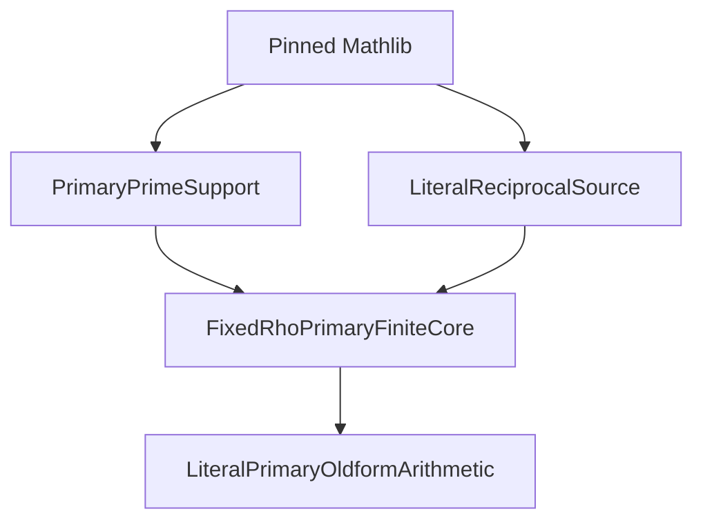

# P3.4 Literal Primary Arithmetic Implementation Plan

> Execution ruling, 2026-11-26: the source inventory and mathematical interfaces below are accepted for Task 2. Root controls cloud acceptance and publication. A fresh assigned implementer may perform the listed source edits and pinned local checks; references below to root-controlled edits/checks describe ownership, not a prohibition on that delegation. The inspected donor snapshot remains unchanged at packet source 145be87ff0a88914b607baa2a330bc88105a08d6.

> **For agentic workers:** REQUIRED SUB-SKILL: Use superpowers:subagent-driven-development (recommended) or superpowers:executing-plans to implement this plan task-by-task. Steps use checkbox (`- [ ]`) syntax for tracking. Root retains all implementation, compilation, and acceptance decisions. This document is a read-only interface analysis; its author has not compiled or changed project sources.

**Goal:** On the existing literal `carrier`, `nonzeroSource`, `primaryFibre`, and grouped `beta`, derive `(n, |a|*nu)=1`, `(|a|*nu, z)=1`, and the ABL integer `K=1`, without introducing a replacement structure or assuming these coprimality conclusions.

**Architecture:** Extract existing public declarations, preserving their full qualified names, into three small source modules, then add one arithmetic consumer module. The actual source objects remain definitionally the existing objects. The new modules need only pinned Mathlib dependencies; neither `OriginalData` nor an analytic Poisson/spectral module is needed for this unit.

**Tech Stack:** Lean and Mathlib at the repository's frozen `lean-toolchain` / `lake-manifest.json`. Reuse the established strict-compilation, leanchecker, inventory, and transitive-axiom gates under root's control.

**Spec:** Root's route-II assignment; frozen manuscript `/workspace/scratch/dcb7c80f70a4/analytic-appendix-1106.tex`, Appendix B at lines 964, 968, 971, and the original finite coefficient at lines 588 and 676. The manuscript repository source is `chen-imbalanced-semiprimes` commit `8ca3f6a7f6bbaf6f67c96e80a5065eca9838e703`, `paper/release-20261106/en/analytic-appendix.tex`.

## Global Constraints

- Source checkout inspected: `/workspace/library-files/p34-proof-work`, HEAD `f3bea5b5ffde5f7d8a3ecef3e6759121abaab92e`.
- Task 1 is being implemented concurrently by root / `p34_packet_impl`. Do not modify its packet/phase files for route II.
- Public declaration names and theorem types being moved must be preserved. Remove their old active definitions and import the new module there; do not create parallel public definitions.
- The immutable `docs/source-only` donor remains unchanged. A future staged consumer must import promoted declarations rather than redeclare them.
- Keep both signs of the integer output. Define the natural positive index as the `natAbs` of the exact signed quotient; do not replace `y` by `|y|` before reconstruction.
- Keep the fixed-unit gates, nonzero output filter, original lambda/omega weights, conjugation, and exact output fibres.
- No new `OriginalData`, `FixedBlock`, arbitrary packet structure, assumed row identity, or new coprimality field.
- No Maass/Eisenstein expansion, Whittaker identification, completeness, Kuznetsov, Kim–Sarnak, Plancherel, or already accepted P3.5 Cauchy/exhaustion work.
- No claim that this closes the four `OriginalData` terminal theorems or identifies fixed-height Fourier coefficients with `R(n)`.
- Root performs all builds and actual code edits. All statements below are proposed interfaces, not newly checked Lean results.

## Review Focus

1. Negative `y`: the signed reconstruction remains `nu * (y / nu) = y`, while the ABL natural index is `(y / nu).natAbs`.
2. Empty fibres, `H=0`, or zero grouped beta: do not manufacture a source witness; a beta consumer requires a genuine nonzero coefficient.
3. `a=0` or zero level: elementary arithmetic may be stronger than the manuscript's spectral domain. Positive-level claims require a real positivity supplier for `T`, and no spectral extension is inferred.
4. Arbitrary `qf` and `v`: uniform `K=1` is an integer formula; it does not assert existence or legality of the corresponding oldform.
5. Declaration migration: preserve public names and all gates, repair private-helper visibility explicitly, and forbid stale project objects or duplicate active definitions in the acceptance inventory.

---

## 1. Availability verdict

**All objects needed for the literal finite arithmetic unit are present as actual source definitions. No missing `FixedBlock` is needed.**

The full chain is:

- `CommonSmoothCutoff.poissonNonzeroFrequencyWindow H` is literally the union of the positive image and negative image of `Finset.Icc 1 H`.
- `Inner = Nat × Int`.
- `finiteInnerCarrier T H = T × poissonNonzeroFrequencyWindow H`.
- `fixedUnit A a t = t.Coprime A ∧ t.Coprime a.natAbs`.
- `level u v = u.1 * v.1`.
- `difference u v = u.2 * v.1 - v.2 * u.1` in integers.
- `outputY f u v = f * difference u v`.
- `Source = Int × (Inner × Inner)`, `Output = Nat × Int`.
- `carrier A a T H F` filters the literal Cartesian product by `f ≠ 0` and both retained fixed-unit gates.
- `output s = (level s.2.1 s.2.2, outputY s.1 s.2.1 s.2.2)`.
- `weight lambda omega s` is the first `atomCoeff` times the star of the second; `beta` sums this weight over the literal output fibre.
- `rhoPrimaryNu a y = supportedPart y.natAbs a.natAbs`, and `primaryFibre` filters by equality to this computed integer.

This is the same existing source object, not an alternative model. The general parameters `T`, `F`, `lambda`, and `omega` are already parameters of the old definitions. A theorem on these unchanged definitions is universal over genuine instances of those definitions. It does **not** assert that the still-uncompiled whole `OriginalData` assembly has been instantiated.

### Exact source locations

All paths in the following table are under `/workspace/library-files/p34-proof-work/`.

| Existing source | Relevant declarations / first line | Additional object dependencies |
|---|---|---|
| `ImbalancedChen/Part3SharedFirstFactorSmallCoreFourierTruncation.lean` | `ImbalancedChen.Part3.CommonSmoothCutoff.poissonNonzeroFrequencyWindow`, line 22 | Finset natural interval, image, union, integer casts only |
| `ImbalancedChen/Part3ActualReciprocalSquarePoisson.lean` | `Inner` 106; `fixedUnit` 110; `atomCoeff` 112; `level` 121; `difference` 123; `outputY` 125; `finiteInnerCarrier` 134 | The frequency-window definition; basic Nat/Int/Complex/Finset operations |
| Same file | `output_level_residue_coprime` 361; `output_level_pos` 366 | The preceding definitions and Nat coprimality / positivity |
| `ImbalancedChen/Part3ActualCompletedSquarePushforward.lean` | `Source` 24; `Output` 25; `rawCarrier` 27; `carrier` 30; `output` 33; `weight` 35; `nonzeroSource` 41; `fiber` 43; `beta` 45 | The preceding literal source definitions |
| Same file | `weighted_pushforward` 50; `beta_ne_zero_mem_image` 91; private `carrier_data` 178; `output_residue_coprime` 186; `output_positive_level` 191 | Finite sum reindexing, filter/product membership, two output-level lemmas |
| `ImbalancedChen/Part3CanonicalReciprocalData.lean` | finite prime-support prefix beginning with `supportedPart` 38 | Pinned Mathlib factorization and finite products only; no CRT declaration is used by this prefix |
| `ImbalancedChen/Part3FixedRhoPrimarySignedFiniteDecomposition.lean` | generic prefix beginning with `rhoPrimaryNu` 31, ending with `finite_primary_original_modulus` 155 | Prime-support prefix and literal source definitions; no `actualNonzeroSource` is used before the final specialized consumer |
| `docs/source-only/20261102-resume-30q/actual_spectral_energy/Part3OriginalRowOldformArithmetic.lean` | `oldformCofactor` 69; private scalar helpers 76 and 81 | These scalar definitions/proofs do not refer to `OriginalData`. The other original-row declarations do |

The generic prefix ends before `actual_primaryFibre_gate` at line 172. That last specialized theorem uses `actualNonzeroSource`, `signedResidue`, and the actual M2 supplier and should remain in the old module for this unit.

## 2. Proposed module layout and declaration inventory

The four proposed module paths did not exist when this plan was written. They are new implementation targets, not completed files.

### A. `ImbalancedChen/Part3PrimaryPrimeSupport.lean`

Move the following **nine required declarations** from `Part3CanonicalReciprocalData.lean`, preserving namespace `ImbalancedChen.Part3.CanonicalReciprocalData`:

1. `supportedPart`
2. `coprimePart`
3. `supportedPart_pos`
4. `supportedPart_mul_coprimePart`
5. `supportedPart_dvd`
6. `prime_dvd_supportedPart`
7. `prime_dvd_coprimePart_not_dvd`
8. `coprimePart_coprime`
9. `coprime_of_prime_support`

`coprimePart_pos` and `coprimePart_dvd` are not needed by route II; leave them in the old module, which imports this new core. The much larger `WGCDData` / CRT portion stays in the old module.

Expected direct imports: `Mathlib.Data.Nat.Factorization.Basic`, `Mathlib.Algebra.BigOperators.Associated`, and only such small tactic imports as required by the unchanged proofs. There is no need to import `Part3ComplexCRTConsumer`.

### B. `ImbalancedChen/Part3LiteralReciprocalSource.lean`

Move exactly the following existing finite declarations:

**Namespace `ImbalancedChen.Part3.CommonSmoothCutoff`:**

- `poissonNonzeroFrequencyWindow`.

**Namespace `ImbalancedChen.Part3.ActualReciprocalSquarePoissonSourceOnly`:**

- `Inner`, `fixedUnit`, `atomCoeff`, `level`, `difference`, `outputY`, `finiteInnerCarrier`.
- `output_level_residue_coprime`, `output_level_pos`.

**Namespace `ImbalancedChen.Part3.ActualCompletedSquarePushforwardSourceOnly`:**

- `Source`, `Output`, `rawCarrier`, `carrier`, `output`, `weight`, `nonzeroSource`, `fiber`, `beta`.
- `weighted_pushforward`, `beta_ne_zero_mem_image`.
- `output_residue_coprime`, `output_positive_level`.
- The membership helper discussed below.

Leave `innerCarrier`, `phase`, `atom`, `finiteReciprocalRow`, all physical Poisson / completed-kernel definitions and proofs, `zeroSource`, `positiveSource`, `negativeSource`, and their finite sign-splitting lemmas in their existing parent modules. They may use the imported finite definitions without changing statements. This avoids pulling `factorCarrier`, reciprocal inverses, Schwartz functions, or actual mode machinery into the new core.

**Private-helper decision:** `carrier_data` is currently private and is used again by the retained `output_support` proof. Promote this helper to a public theorem named `ImbalancedChen.Part3.ActualCompletedSquarePushforwardSourceOnly.carrier_data` in the new core, with exactly the current type and proof, and remove its old private declaration. The parent module then resolves its existing calls to the new public helper. This is an explicitly new public name; a private Lean name includes its defining module and is not a public name-preservation claim. Record this one visibility change in the inventory and review. No theorem's hypotheses or conclusion change.

Expected Mathlib support: `Mathlib.Data.Finset.Prod`, `Mathlib.Order.Interval.Finset.Nat`, `Mathlib.Data.Nat.GCD.Basic`, `Mathlib.Data.Complex.Basic`, and `Mathlib.Algebra.BigOperators.Group.Finset.Basic`; the latter contains `sum_fiberwise_of_maps_to`. Add exact small tactic imports if the pinned parser requires them. Project imports are unnecessary.

### C. `ImbalancedChen/Part3FixedRhoPrimaryFiniteCore.lean`

Move the **21-declaration generic prefix** of `Part3FixedRhoPrimarySignedFiniteDecomposition.lean`, preserving namespace `ImbalancedChen.Part3.FixedRhoPrimarySignedFiniteSourceOnly`:

- `rhoPrimaryNu`, `rhoPrimaryQuotient`.
- `rhoPrimaryNu_pos`, `rhoPrimaryNu_dvd_natAbs`, `rhoPrimaryNu_dvd`, `rhoPrimary_reconstruct`.
- `rhoPrimaryQuotient_natAbs`, `rhoPrimaryQuotient_coprime`, `rhoPrimaryQuotient_ne_zero`, `rhoPrimaryNu_prime_support`, `rhoPrimary_spec`.
- `primaryKeys`, `primaryFibre`, `mem_primaryFibre_iff`, `source_mem_own_primaryFibre`, `primaryFibre_key_unique`, `primaryKeys_pos`, `primaryKeys_prime_support`, `primaryFibre_gate`.
- `finite_primary_decomposition`, `finite_primary_original_modulus`.

Its only project imports are modules A and B. Preserve the literal statements of the finite sum and original-modulus identities. Remove unused `open` commands for `ActualModeBetaPositiveCountSourceOnly` and other namespaces supplied only by heavy original imports. The specialized `actual_primaryFibre_gate` remains in the old module with its real existing dependencies.

Expected additional Mathlib support: integer division / `natAbs` lemmas, notably the API currently used as `Int.natAbs_ediv_of_dvd`, `Int.natCast_dvd`, and `Int.mul_ediv_cancel'`. Their exact accessibility/import spelling must be resolved under root's pinned compile. This is an API check, not an unavailable project object or a proposed mathematical assumption.

### D. `ImbalancedChen/Part3LiteralPrimaryOldformArithmetic.lean`

Import module C. Reuse the scalar declaration

`ImbalancedChen.Part3.OriginalRowOldformArithmetic20261102.oldformCofactor (z qf v : Nat) : Nat := z / Nat.gcd (v * qf) z`

from the archived donor, under its original full public name. Keep the archive unchanged. Record it as a promoted source-only declaration. Do not also define it in another active module. A future staged `OriginalRowOldformArithmetic` must import it and omit its old duplicate definition.

Reuse the donor proofs of `oldformCofactor_dvd` and `supportedPart_eq_one_of_coprime` as private scalar helpers in this new module. Their private serialized names will differ with the new defining module. Neither proof needs `OriginalData`.

Add the two genuine source consumers specified below under a new namespace such as `ImbalancedChen.Part3.LiteralPrimaryOldformArithmetic`. Do not reuse the old `original_*` terminal names for different theorem types.

## 3. Exact consumer interfaces and proof suppliers

Abbreviations in this section are for presentation only. They are not instructions to create replacement source types:

- `U := nonzeroSource (carrier A a T H F)`.
- For a source member, `z := (output s).1`, `y := (output s).2`, and `n := (y / (nu : Int)).natAbs`.

### Consumer 1: membership in the actual computed fibre

Proposed interface:

```lean
theorem literal_primaryFibre_abl_licenses
    {A : ℕ} {a : ℤ} {T : Finset ℕ} {H : ℕ} {F : Finset ℤ}
    {nu : ℕ} {s : Source}
    (hs : s ∈ primaryFibre a (nonzeroSource (carrier A a T H F)) nu) :
    let z := (output s).1
    let y := (output s).2
    let n := (y / (nu : ℤ)).natAbs
    0 < nu ∧ y ≠ 0 ∧ (nu : ℤ) ∣ y ∧
      (nu : ℤ) * (y / (nu : ℤ)) = y ∧ 0 < n ∧
      n.Coprime (a.natAbs * nu) ∧
      (a.natAbs * nu).Coprime z ∧
      ∀ qf v : ℕ,
        supportedPart (oldformCofactor z qf v) (a.natAbs * nu) = 1
```

Every needed fact comes from existing definitions or proved suppliers:

1. `mem_primaryFibre_iff` supplies membership in `U` and `rhoPrimaryNu a y = nu`.
2. The original `nonzeroSource` filter supplies `y ≠ 0`; its underlying membership supplies `s ∈ carrier A a T H F`.
3. Rewrite `rhoPrimaryNu_pos`, `rhoPrimaryNu_dvd`, `rhoPrimary_reconstruct`, and `rhoPrimaryQuotient_ne_zero` by the key equality. Use `Int.natAbs_pos.mpr` for positivity of `n`.
4. `primaryFibre_gate` gives `n.Coprime a.natAbs`; `rhoPrimaryNu_prime_support` and the same key equality give the prime support of `nu`.
5. The exact existing combination from donor `original_index_coprime_abl_argument` is `hna.mul_right (coprime_of_prime_support hna hsupport)`.
6. `output_residue_coprime` derives `haz : a.natAbs.Coprime z` from the actual carrier. Set `hnuz := (coprime_of_prime_support haz.symm hsupport).symm`; then `haz.mul_left hnuz` proves `(a.natAbs * nu).Coprime z`.
7. `oldformCofactor_dvd z qf v` and `.of_dvd_right` give the needed coprimality with the cofactor. Apply the unchanged finite-product proof `supportedPart_eq_one_of_coprime`.

No `hT`, `a ≠ 0`, legal-oldform label, spectral function, or norm estimate is necessary for this arithmetic interface. Do not silently infer the manuscript's positive-level spectral domain from this fact.

### Consumer 2: the actual grouped beta has the same arithmetic licences

Proposed interface:

```lean
theorem literal_primaryBeta_abl_licenses
    {A : ℕ} {a : ℤ} {T : Finset ℕ} {H : ℕ} {F : Finset ℤ}
    {nu : ℕ} {lambda : ℕ → ℂ} {omega : ℤ → ℂ} {zy : Output}
    (hb : beta (primaryFibre a (nonzeroSource (carrier A a T H F)) nu)
      lambda omega zy ≠ 0) :
    let n := (zy.2 / (nu : ℤ)).natAbs
    0 < nu ∧ zy.2 ≠ 0 ∧ (nu : ℤ) ∣ zy.2 ∧
      (nu : ℤ) * (zy.2 / (nu : ℤ)) = zy.2 ∧ 0 < n ∧
      n.Coprime (a.natAbs * nu) ∧
      (a.natAbs * nu).Coprime zy.1 ∧
      ∀ qf v : ℕ,
        supportedPart (oldformCofactor zy.1 qf v) (a.natAbs * nu) = 1
```

Proof supplier: `beta_ne_zero_mem_image hb`, then `Finset.mem_image.mp`, then Consumer 1 and the actual output equality. This retains all arithmetic multiplicities and complex weights; it does not replace beta by a count, positive envelope, or independent function.

For a later actual cusp consumer that needs `0 < zy.1`, use the existing `output_positive_level` with its precise premise `hT : ∀ t ∈ T, 0 < t`. The above witness proof immediately transfers that result to `zy`. Do not add a positivity field to the source. This additional wrapper is optional for the current three-target arithmetic unit.

### Why these interfaces are genuinely about the old source

The endpoint premises mention the original `carrier` and original `primaryFibre` directly, not a structure carrying the desired conclusions. `nu` is certified as the value of the actual computed key; the coprimality of the level is recovered from both original fixed-unit filters. The beta endpoint obtains a real source witness before using any arithmetic result.

Neither endpoint asserts an equality between the full `OriginalData` source and a newly introduced object. When the full `OriginalData` definitions are available and admitted later, their existing `originalSource = carrier 1 ...` definition can instantiate these universal results without changing the result types here.

## 4. Import topology and parent-file edits

Expected topology:



Original active parents that must import their extracted definitions and remove their old active declarations:

- `/workspace/library-files/p34-proof-work/ImbalancedChen/Part3CanonicalReciprocalData.lean` → A.
- `/workspace/library-files/p34-proof-work/ImbalancedChen/Part3SharedFirstFactorSmallCoreFourierTruncation.lean` → B.
- `/workspace/library-files/p34-proof-work/ImbalancedChen/Part3ActualReciprocalSquarePoisson.lean` → B.
- `/workspace/library-files/p34-proof-work/ImbalancedChen/Part3ActualCompletedSquarePushforward.lean` → B.
- `/workspace/library-files/p34-proof-work/ImbalancedChen/Part3FixedRhoPrimarySignedFiniteDecomposition.lean` → C.

Do not remove parent analytic imports merely because the finite prefix no longer needs them: their retained theorems still do. The new route-II audit should compile the four small modules; a claim about all five large parents would need its own gate and is not part of this unit.

There is no mandatory project import from route-II modules to the seven accepted cusp modules or Task 1's new packet modules. The finite arithmetic unit is independent of them. A later consumer can combine both accepted units.

## 5. Prior verification evidence and limits

The seven-module source `3b3aa92475d0d6ab12a0652cc6cf2561afb99ac7` remains valid evidence for its original 113 declarations. It is not evidence that the route-II files are already accepted.

One useful existing historical result was checked directly:

- Receipt: `/workspace/library-files/p34-proof-work/verification/proof-continuation/2026-10-15/compilation/20261015T182803267502Z-ImbalancedChen.Part3CanonicalReciprocalData/receipt.json`.
- Status `PASS`, exit code 0, warnings as errors, source hash `27fbab6bd34d3f06767891e13009f82022375190bffa1ea7ab4f7fe7779c6d8f`.
- The current complete `Part3CanonicalReciprocalData.lean` has that exact hash.
- The receipt explicitly scopes itself to **normal-trust development compilation only; no final acceptance claim**. Reuse its source and proofs, but do not label a newly extracted module kernel-accepted without root's new strict/replay/audit gate.

No route-II donor was compiled or recompiled for this plan. No external spectral foundation is assumed just because an old header or registry mentions it.

## 6. Tasks for root-controlled implementation

### Task A: Preserve and extract the actual finite objects

**Files:** Create modules A and B; modify only their four active donor parents named above.

**Consumes:** The original definitions and proofs listed in sections 1 and 2.

**Produces:** The same public constants and types, plus the explicitly documented public `carrier_data` helper.

- [ ] Record the original declaration text and hashes before edits; preserve donor provenance.
- [ ] Move the nine prime-support declarations into A and add the import to the old parent.
- [ ] Move the listed literal-source declarations into B; preserve the frequency-window formula exactly.
- [ ] Perform the specified private-helper promotion and remove old active declarations.
- [ ] Root checks a declaration-level diff and absence of duplicate active public definitions; in particular inspect signed output, fixed units, and the starred second coefficient.
- [ ] Root strictly compiles A and B with the frozen dependencies and fresh project objects. Success means both complete without warnings/errors; this alone is not final acceptance.

### Task B: Preserve the generic primary decomposition

**Files:** Create C; modify `Part3FixedRhoPrimarySignedFiniteDecomposition.lean` to import C and retain its actual-mode consumer.

**Consumes:** The original 21-declaration prefix and modules A/B.

**Produces:** The same computed primary keys/fibres, signed reconstruction, exact finite partition, and original-modulus identity.

- [ ] Move the prefix with unchanged public types; remove only obsolete namespace opens from the new file.
- [ ] Root strictly compiles C and resolves only actual pinned-API failures, recording any proof repair separately from declaration moves.
- [ ] Review the theorem types for signed `y`, exact quotient, arbitrary original payload, and unchanged physical `c`/`rho` parameters.

### Task C: Add actual carrier and beta consumers

**Files:** Create D. Keep the archived `Part3OriginalRowOldformArithmetic.lean` unchanged.

**Consumes:** C, the scalar cofactor definition, and the two existing scalar proof bodies.

**Produces:** `literal_primaryFibre_abl_licenses` and `literal_primaryBeta_abl_licenses` with the exact proposed types.

- [ ] Promote `oldformCofactor` under its existing full public name and record the archive source/hash.
- [ ] Reuse the scalar cofactor-divisibility and supported-part proof bodies locally.
- [ ] Implement the source-membership consumer by the seven proof-supplier steps above.
- [ ] Implement the beta consumer using a genuine nonzero-beta source witness.
- [ ] Root strictly compiles D. Review the full elaborated theorem types, especially that no coprimality conclusions or substitute row equalities became premises.

### Task D: Root's acceptance and scope report

**Files:** Root's current P3.4 runner/audit configuration, plus a route-II evidence report. Use a dedicated four-module inventory or explicitly extend the current new-unit inventory; do not run the old fixed seven-module scope and describe that as route-II acceptance.

- [ ] The root-owned runner must enforce its exact clean source HEAD and the same frozen dependency/toolchain pins.
- [ ] Check actual Lean-resolved imports: only earlier freshly rebuilt project modules or the fixed external roots are allowed. None of the new four modules should resolve to old heavy project parents.
- [ ] Run four strict compilations and four leanchecker replays, then complete defining-module / serialized declaration inventories and transitive-axiom checks.
- [ ] Inspect edge cases via the theorem types and proof dependencies: both signs, empty source, zero beta, `a=0`, and unrestricted integer cofactor labels. Small Lean examples are optional only if they resolve a concrete ambiguity; avoid parallel implementation-mirroring tests.
- [ ] Record source/object hashes and the promoted/private-name changes. Preserve the original seven-module and P3.5 evidence separately.
- [ ] Publish the precise finite-arithmetic scope only after that gate. The full `OriginalData` terminals, physical trace normalization, and P3.4 spectral estimates remain outside it.

## 7. Explicit unavailable / deferred objects

- **Not required here:** `OriginalMediumPhysicalE3Block.FixedBlock` and its complete original definition closure. This remains a blocker for claiming the archived `OriginalData` terminals themselves are freshly closed, not for the literal carrier unit.
- **Not required here:** `ActualFrickeNonzeroFourier` and the physical completed-Eisenstein Fourier supplier.
- **Not imported here:** `actualNonzeroSource`'s full actual M2 / mode closure. Its existing definition is present in `/workspace/library-files/p34-proof-work/ImbalancedChen/Part3ActualModeJointBetaPositiveCount.lean` at line 89 and literally instantiates `nonzeroSource (carrier ...)`; compiling that entire specialized assembly is a separate unit.
- **No missing object found in the proposed four-module finite closure.** Exact tactic and Mathlib API accessibility remains to be established by root's requested future compile; source inspection alone is not that verification.

## 8. Source fingerprints for the inspected donor snapshot

| Donor | SHA256 |
|---|---|
| `Part3CanonicalReciprocalData.lean` | `27fbab6bd34d3f06767891e13009f82022375190bffa1ea7ab4f7fe7779c6d8f` |
| `Part3SharedFirstFactorSmallCoreFourierTruncation.lean` | `14e7d51db4f2b507dc06ff16d16f1d1c34479a7b9c090b7a12615aa089af5a02` |
| `Part3ActualReciprocalSquarePoisson.lean` | `4dd4d1487658283645a8c7857864df5448deb665828ac7c4a6cade294872b60e` |
| `Part3ActualCompletedSquarePushforward.lean` | `17dd930a8ed88c4f4e35c5a4eacc7d61aa77972a5742963942f1751b3c13a1ef` |
| `Part3FixedRhoPrimarySignedFiniteDecomposition.lean` | `7a9c64b902f314265eb61c737d6fc419309ebac59f669e7f96f817d5beb58095` |
| Archived `Part3OriginalRowOldformArithmetic.lean` | `fbda3e52f45e76e76330ffad9e01e054297c047af8b9ba749e23263288c76e5b` |

The task-1 working-tree changes observed during this analysis are intentional parallel implementation work; they are not evidence of an unclean earlier acceptance run. This plan itself changes no project file or index entry.
